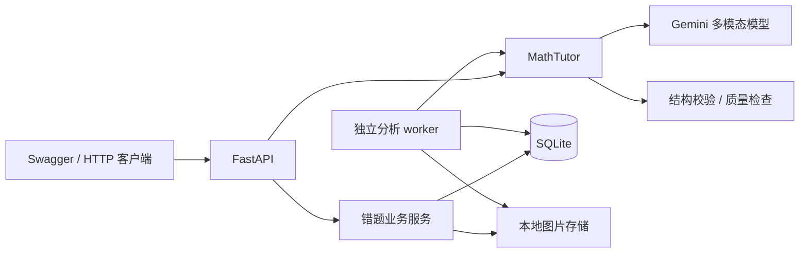

# Math Tutor Agent

基于 Gemini 多模态能力的数学辅导后端，用 Python / FastAPI 实现图片识题、结构化解答、知识点关联、启发式问答，以及错题收录、作答诊断和复习管理。

## 核心能力

- **结构化题目分析**：核心与细分知识点、解题步骤、步骤关联知识点；Pydantic 校验引用关系和结果状态。
- **解答质量检查**：本地精确数值核验、风险模型复核、最多一次修复；无法确认时返回待确认结果。
- **多轮辅导**：按可选年级组织提示、检查学生步骤，限制会话容量与对话轮数。
- **错题闭环**：图片与分析版本、重复提醒、练习提示记录、作答诊断、复习日程与统计。
- **可靠后台任务**：SQLite 持久化队列、租约续期、版本检查、有限重试及文件清理。
- **工程基础**：pydantic-settings 配置、Loguru 请求关联与脱敏、可注入模型客户端、离线回归测试。

## 架构



普通辅导会话保存在 API 进程内存中；错题、作答、任务和复习记录持久化。HTTP 服务与 worker 分开运行，使用相同数据库及图片目录。设计取舍见 [架构说明](docs/ARCHITECTURE.md)。

## 快速启动

需要 Python 3.11+。下载或克隆仓库后，在包含 `pyproject.toml` 的项目根目录执行：

```bash
python3 -m venv .venv
source .venv/bin/activate
python -m pip install -e '.[dev]'
cp .env.example .env
```

在 `.env` 填入自己的 `GOOGLE_API_KEY`，并设置账号可用的 `GEMINI_MODEL`。密钥只在后端使用。默认模型名称可配置，未验证账号模型权限。

```bash
python -m uvicorn math_tutor.api:app --host 127.0.0.1 --port 8000
```

打开 [Swagger](http://127.0.0.1:8000/docs)。上传图片可直接调用 `POST /v1/analyze/image`，`grade` 可选，范围为 1–6。

```bash
curl --fail-with-body http://127.0.0.1:8000/v1/analyze \
  -H 'Content-Type: application/json' \
  -d '{"text":"24块饼干平均分给6人，每人几块？","grade":3}'

# 将 question.jpg 替换为自己的题目图片
curl --fail-with-body http://127.0.0.1:8000/v1/analyze/image \
  -F 'image=@./question.jpg' -F 'grade=3'
```

返回结果包含 `status`、`problem_text`、`core_knowledge_points`、`detailed_knowledge_points`、`steps`、`answer` 和 `clarifications`。`status=needs_clarification` 时应提示用户核对条件，不展示答案。完整调用流程见 [接口文档](docs/API_GUIDE.md)，可直接使用 [HTTP 示例](examples/analyze.http)。

### 体验错题管理

在 `.env` 启用仅用于回环地址调试的身份：

```dotenv
TUTOR_ENABLE_LOCAL_IDENTITY=true
TUTOR_LOCAL_STUDENT_ID=11111111-1111-4111-8111-111111111111
```

重启 API，并在另一个终端激活相同虚拟环境、进入相同项目目录启动：

```bash
python -m math_tutor.mistakes.cli
```

按 [错题调用流程](docs/API_GUIDE.md) 上传图片、查询分析结果、创建练习、提交作答和查看复习安排。未运行 worker 时分析保留在 `pending`。本地身份默认关闭，错题接口默认返回 401。

## 案例展示

[图片题目 → 知识点 → 10 步解答](docs/cases/rational-equation.md)：含原题截图、生成的 JSON、独立数学核对和输出改进点评。此例为初中扩展题，不代表已完成初中场景评测。

## 开发与验证

```bash
python -m pytest -q
python -m compileall -q src
```

整理时在 Python 3.12 下验证 **142 项离线测试通过**。测试覆盖真实 Google SDK 配合模拟 HTTP 响应、FastAPI 请求、配置校验、图片处理、结构化输出、质量检查、任务恢复、幂等提交、数据隔离及复习事务。无需真实 API Key，不会调用 Gemini；这不代表真实题目正确率。CI 对 Python 3.11 / 3.12 执行安装、测试与构建，首次推送后的运行状态以 GitHub Actions 为准。

更多开发约定见 [CONTRIBUTING](CONTRIBUTING.md)，评测边界见 [验证说明](docs/VALIDATION.md)。

## 目录

```text
src/math_tutor/
  api.py              # HTTP 接口与生命周期
  agent.py            # 模型调用、多轮辅导、分析编排
  analysis.py         # 输出契约与分析提示词
  quality.py          # 本地核验、复核与修复协议
  settings.py         # 配置校验
  images.py           # 图片规范化与限制
  logging.py          # 请求日志与脱敏
  mistakes/           # 错题业务、存储、独立 worker 与 SQL 迁移
tests/               # 离线回归测试
docs/                # 架构、API、配置及验证说明
examples/            # HTTP 调用示例
```

## 当前边界

这是可运行的后端原型，没有配套学生前端。普通会话在重启后丢失；建议单个 Uvicorn worker。错题采用 SQLite 与本地存储，尚未完成多实例部署。

项目未提供完整账号认证、限流或计费；独立分析和普通会话接口当前不要求身份，公开部署前需统一保护。知识点编号仅在单次分析中有效，尚未实现正式题库、教材映射、知识图谱或自适应推荐。模型复核无法保证数学正确性，尚无真实题集准确率、教学效果或并发压测结果。

[完整使用与配置说明](docs/USAGE.md) · [架构说明](docs/ARCHITECTURE.md) · [项目讲解提纲](docs/PORTFOLIO.md)
