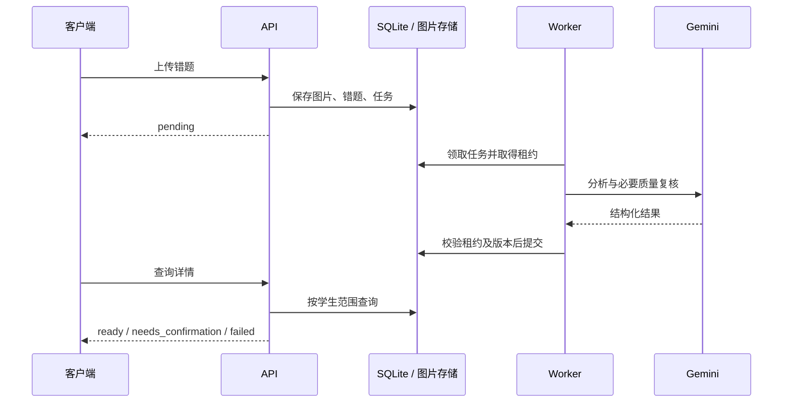

# 架构与设计取舍

## 目标与边界

支持从一道题的图片或文字输入，到结构化讲解、学生追问、错题收录、重做判定与复习安排的后端流程。小学数学是首期交互目标，`grade` 仅接受 1–6；模型可处理其他数学题并不意味着已对初高中效果完成验证。

系统没有采用自动规划、任意工具执行的通用 Agent 框架，而是用固定业务流程编排模型请求。模型负责识题、讲解、语义判断；程序负责契约校验、数据权限、任务状态、有限重试与学习记录。这样能明确失败边界，便于测试。

## 模块职责

| 模块 | 职责 | 关键边界 |
| --- | --- | --- |
| `api.py` | 独立分析与内存会话 HTTP 接口、应用生命周期 | 输入限制与请求 ID |
| `agent.py` | Gemini 调用、对话历史、分析和判题编排 | 可注入客户端；单实例串行访问 |
| `analysis.py` | 分析 schema 与教学提示词 | 连续步骤、知识点唯一及引用关系、状态一致性 |
| `quality.py` | 数值解析与质量评审协议 | 限制 AST 运算及大小；不执行任意表达式 |
| `settings.py` | 环境与 dotenv 配置 | 类型校验、不可变配置与隐藏密钥 |
| `images.py` | 上传图片解码与规范化 | 格式、大小、像素、多帧限制和元数据清理 |
| `mistakes/router.py` | 错题 HTTP 契约 | 学生身份依赖与资源访问 |
| `mistakes/service.py` | 业务事务、练习、作答、教师修正 | 幂等提交、题目版本、审计与复习更新 |
| `mistakes/repository.py` | 错题数据查询与写入 | 学生范围查询和分页 |
| `mistakes/worker.py` | 分析任务领取、续租及提交 | 有限重试、失效任务拒绝提交 |
| `mistakes/review.py` | 复习状态计算 | 日期、间隔及独立完成规则 |
| `mistakes/storage.py` | 私有图片文件管理 | 数据库授权后读取、引用及孤儿清理 |

## 即时分析流程

1. API 校验输入，图片经规范化后转换为模型输入。
2. Gemini 通过原生 `response_json_schema` 返回结构化内容，避免 SDK schema 转换丢失 JSON Schema 字段。
3. Pydantic 校验结果：知识点编号不重复、细分知识点有父项、步骤编号连续、引用已定义、答案与状态一致。
4. 本地质量检查使用 `Fraction` 精确计算有限数值等式，检查部分条件遗漏和答案不一致。符号表达式或不能解析的公式不直接判错。
5. 默认对复杂或无法核验的结果进行模型复核；发现问题时最多修复一次，再次检查。复核要求在修复后保留，避免删公式绕过检查。
6. 最终返回完整分析或待确认状态。质量检查记录状态和代码，完整输出不写日志。

最多四次应用层模型请求；SDK 内部网络重试不计入此上限。此流程增加延迟与费用，且模型复核并非形式化证明。普通聊天与学生作答判题不自动进入该流程。

## 错题分析与恢复

题目图片、错题元数据和分析任务在收录后保存；API 返回任务状态，独立 worker 从数据库领取任务。worker 通过租约和续租保持所有权，提交时同时检查题目版本和有效租约。

网络错误、429 或上游 5xx 可在首次失败后重试三次，等待 2 / 10 / 30 秒；400 等错误不自动重试。worker 崩溃后，过期租约允许任务被重新领取。题干修正会更新版本、取消旧任务；旧分析不能覆盖新题目。

删除资源先撤销数据库访问，清理任务负责最终删除图片。异常退出产生的孤儿文件在启动及周期扫描时处理，仅清理超过 24 小时且未被数据库引用的文件。

## 作答与复习

作答提交使用持久化幂等记录和租约，减少重复请求产生的重复作答及模型请求。练习提示次数由服务端记录；无法确定的判定不推进学习状态。教师修正为内部服务方法，保留理由、操作者及原判定，并重算复习安排，没有公开教师 HTTP 接口。

作答落库与复习日程在事务中更新。默认间隔为 `[1,3,7]` 天，同日重复独立正确不晋级；满足不同当地日期和到期复习要求才标记掌握，之后继续巩固。UTC 保存时间，学生时区决定跨日。

## 选择与代价

- **FastAPI + Pydantic**：共享 Python 类型契约与 OpenAPI；严格 schema 不等于数学正确。
- **SQLite + 本地文件**：减少首期部署依赖，便于演示任务恢复；暂不适合多实例共享和大规模并发。
- **独立 worker**：避免 API reload 重复执行后台任务；需要同时管理两个进程。
- **内存会话**：简单且限制容量；重启丢失，多个 API worker 不共享会话。
- **原生多模态模型**：不维护单独 OCR 管线；识别和教学依赖模型，复杂图片仍需确认。

后续扩展应先根据真实评测和负载决定是否引入共享数据库、对象存储及外部队列，而不是提前增加所有依赖。
