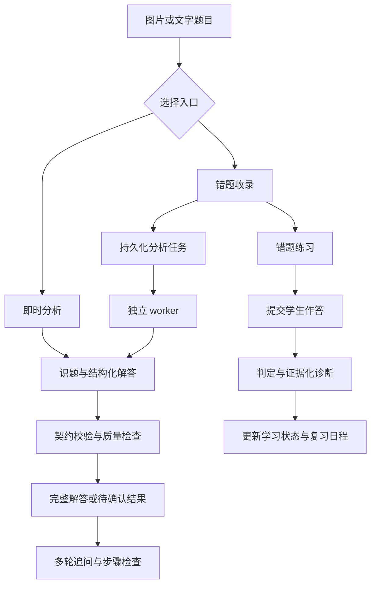

# 项目设计与实现

## 项目背景与目标

数学辅导需要处理的不只是答案，还包括题干是否识别完整、解题依据是否清楚、学生究竟错在哪一步，以及后续是否能够独立完成。单次模型调用可以生成讲解，但不会自动建立作答记录、处理重复提交或安排复习。

Math Tutor Agent 将多模态模型接入一个明确的教学业务流程：接收题目图片或文字，生成带知识点关联的结构化分析，支持学生继续追问，并通过错题管理保存分析、练习和复习记录。支持小学、初中和高中数学，年级可选，统一使用 1–12；未知年级时采用题目所需的方法，不擅自判断学生学段。

当前交付为 Python 后端，提供 FastAPI 服务、命令行和可嵌入的 Python 接口。用户可通过 Swagger 上传图片、发起问答和体验错题流程。系统尚未配套学生前端，也未实现完整账号系统。

## 业务流程

系统提供两种题目分析入口。即时分析直接返回结果，适合临时答疑；错题收录保存图片和题目记录，创建后台任务，适合后续练习与复习。两种入口共用同一分析逻辑，但即时分析不会自动写入错题本。

普通会话与错题练习具有各自的状态。普通会话保留上下文，支持启发式提示、完整解答、步骤检查和题干识别；错题练习单独记录提示次数、题目版本和是否已提交作答。普通会话中的提示不会自动计入错题练习。

## 系统架构

HTTP 层负责参数校验、请求关联、会话生命周期和资源访问。模型层组织题目、图片、学生作答与教学提示，并将模型响应转换成可检查的数据。错题业务层负责持久化、练习、作答和复习事务；独立 worker 执行耗时分析，避免在 HTTP 进程重载时重复启动任务。

| 层次 | 主要实现 | 职责 |
| --- | --- | --- |
| 服务入口 | FastAPI、CLI | 即时分析、会话、错题、作答和复习接口 |
| 模型编排 | `agent.py`、`prompts.py` | Gemini 请求、历史管理、教学模式和分析流程 |
| 分析契约 | `analysis.py` | 题干、知识点、步骤、答案与状态约束 |
| 质量检查 | `quality.py` | 本地数值核验、复核协议与修复规则 |
| 错题业务 | `mistakes/service.py`、`diagnosis.py`、`review.py` | 作答判定、幂等、诊断及复习状态计算 |
| 数据与任务 | SQLite、SQL 迁移、文件存储、worker | 持久化、版本、租约及恢复 |
| 每日学习 | `learning/`、独立 scheduler | 知识点表现、每日任务、按学生时区定时生成 |
| 运行支持 | pydantic-settings、Loguru、pytest | 配置校验、日志与离线验证 |

系统采用固定业务流程编排模型能力，执行顺序和修复上限由程序控制，没有引入模型自动规划或任意工具执行。模型负责识别、讲解与语义判断；数据权限、事务、任务所有权和复习规则由确定性的业务代码执行。

更详细的模块边界与部署取舍见 [架构说明](ARCHITECTURE.md)。

## 题目分析的实现

### 图文输入

图片经过格式、文件大小、像素数和帧数校验，再规范化为 PNG，并清理元数据。支持 PNG、JPEG 和 WebP；单张图片不超过 10 MiB、1600 万像素，整个请求体限制为 14 MiB。文字、图片和已有学生笔迹作为分析材料传入 Gemini。

图片识别和解答由同一多模态模型处理，不维护独立 OCR 服务。提示词要求区分题干和学生笔迹；条件缺失或图片有歧义时请求确认，不补写无法识别的内容。

### 结构化结果

模型通过原生 JSON Schema 返回 `ProblemAnalysis`，包含以下字段：

| 字段 | 内容 |
| --- | --- |
| `status` | `solved`、`needs_clarification` 或 `unsupported` |
| `problem_text` | 识别出的题干、条件和选项 |
| `core_knowledge_points` | 主要考查的概念或方法 |
| `detailed_knowledge_points` | 核心概念下的具体技能，以及对应父项 |
| `steps` | 连续编号的解题步骤、公式、知识点引用及应用说明 |
| `answer` | 最终答案，待确认或不支持时为空 |
| `clarifications` | 需要确认的问题或不支持原因 |

Pydantic 在本地进一步检查知识点编号是否唯一、细分项是否引用有效父项、步骤编号是否连续，以及步骤引用是否已定义。已解答结果必须包含核心知识点、步骤和答案；待确认结果不得同时给出答案或解题步骤。

知识点编号只在单次分析内有效。当前保留了后续映射的数据结构，但没有完成正式教材目录映射或跨题知识图谱构建。

### 分步讲解

教学提示词要求先写必要条件，再进行运算；保留关键中间等式、符号变化、边界判断与验根。每步关联知识点并说明其应用，便于用户追问某个具体步骤。

普通问答默认使用提示模式，每轮提供下一步线索并等待作答；学生明确要求完整解答时可以分步解释。提示是否恰当仍依赖模型，当前没有通过强制规则保证所有回答都不泄露答案。

## 解答质量检查

结构合法只表示返回数据能够被程序使用，不能保证数学结论正确。因此，结构化分析在返回前还会经过本地检查，并按配置触发模型复核。

本地检查使用受限的 AST 解析和 `Fraction` 精确运算核验可解析的数值等式。解析器限制表达式长度、数字大小、节点数量和指数范围，不执行任意代码。检查还覆盖部分分式定义域遗漏、数值答案不一致，以及计算描述缺少公式的情况。

符号公式无法解析时记录为待进一步核验，不直接判错。默认 `on_risk` 模式对复杂题型或无法核验的结果调用模型复核；`always` 对通过本地检查的结果也复核；`off` 保留本地检查并关闭模型复核。

发现问题后最多修复一次，并重新校验。原结果需要复核时，修复后仍保留这一要求，避免模型通过删掉公式绕过检查。无法确认、修复失败或复核失败时返回 `needs_clarification`，保留题干并清空解题步骤和答案。

最复杂路径最多包含四次应用层模型调用：首次分析、复核、一次修复和再次复核，SDK 内部网络重试不计入这一上限。该策略以增加部分费用和延迟换取更明确的失败处理，但不能替代数学证明或人工题集评测。普通聊天和学生作答判定有自己的处理规则，不进入这一分析质量流程。

## 错题、作答与复习

### 题目版本与分析快照

错题记录保存学生归属、题干、图片、年级、备注、分析状态和学习状态。分析结果按题目版本保存，并记录模型、提示词及质量策略版本，便于追踪结果来源。

修正题干会产生新版本并重新分析。worker 提交结果时检查当前题目版本，防止旧任务覆盖修改后的内容。仅修改备注或年级不会自动重新分析，可显式调用分析接口。

### 持久化任务与故障恢复

分析任务保存在 SQLite 中。worker 领取任务时生成租约令牌，执行期间续租，完成后检查租约仍有效、题目版本仍匹配，再提交结果。进程中断后，过期租约允许其他执行者重新领取任务。

网络错误、429 和上游 5xx 可在首次失败后重试三次，分别等待 2、10、30 秒；400 等请求错误不自动重试。图片清理由持久化清理任务与孤儿扫描配合完成，减少进程异常退出后的遗留文件。

### 作答判定与错因诊断

学生可以提交文字或图片作答。对于完整、无单位的十进制数值答案，程序可以使用 `Decimal` 比较；表达式、文字说明、图片或带单位作答交给模型评阅。结果分为 `correct`、`incorrect` 和 `undetermined`。

错因诊断必须引用实际学生作答中的证据，类别覆盖概念、读题、方法、计算、单位、步骤缺失及未知原因。只有明确判错时生成诊断；缺少过程不能凭题目特点臆造学生的错误步骤。

提交记录使用持久化幂等键、输入摘要和处理租约，控制重复请求。服务器记录练习提示次数并据此区分独立完成与辅助完成；作答落库和复习更新在同一事务中完成。内部教师修正方法保存操作者、理由和原判定，并重算日程，当前未开放教师 HTTP 接口。

### 复习安排

默认复习间隔为 1、3、7 天。同一天重复独立答对不推动阶段晋级；至少两个不同学生当地日期独立答对，并通过一次已到期复习，才标记掌握，之后继续安排巩固。

答错或辅助完成缩短后续复习间隔，无法判定的作答不改变学习状态。时间统一以 UTC 保存，学生时区用于判断日期边界。这是明确的规则策略，尚未实现基于学习数据训练的自适应推荐。

## 每日任务与知识点表现

系统将时间安排与教学判断分开：现有 Agent 处理提示、判答与错因；规则服务负责知识点证据聚合及每日选题。学生既可手动生成，也可开启每日定时生成；任务以学生和当地日期唯一，重复触发返回原任务。

能力表现使用最近 30 个当地自然日内的独立答题，结合不同题目、不同日期及明确知识点诊断，分为证据不足、需加强、初步掌握和较稳定。题目答错并不意味着所有涉及知识点均有问题；使用提示的作答用于安排复习，但不作为独立掌握证据。

当前具备知识点目录维护命令，未提供完整教材目录。已确认映射使用稳定 ID，模型局部 ID 仅用于绑定对应分析。每日任务优先到期错题，完成状态由真实关联答题推进，完成一次复习不等同于掌握。定时进程只生成任务，不向外发送通知。

## 运行、权限与可观测性

配置由 pydantic-settings 管理，优先级为显式参数、环境变量、dotenv 文件和默认值。配置实例不可变，API Key 使用 `SecretStr`，不在正常配置显示中暴露。API、分析 worker 和每日 scheduler 使用同一数据库及配置；API 与分析 worker 使用同一图片目录。

错题接口通过学生身份依赖限制数据范围，图片只能在校验所有权后读取。本地调试身份默认关闭，仅支持回环地址；完整登录、Token 校验和角色权限需要部署时接入。独立分析和普通会话接口当前没有统一认证保护。

Loguru 使用请求 ID 关联日志，记录模型请求耗时、错误类别、任务状态及质量检查结果，不记录密钥、图片、原始题干、学生作答或完整模型输出。普通会话保存在内存中，设置容量与轮数上限；重启会丢失上下文，多 API 进程之间不共享会话。

## 案例与验证

[分式方程与不等式组案例](cases/rational-equation.md) 展示了图文输入到结构化输出的实际形式：两个核心知识点、三个细分知识点和十个关联步骤。独立推导核对了分母禁值、正根条件、不等式边界、整数枚举与最终答案 `A. 10`。

该案例是初中数学样例，保留了用户提供的截图和生成 JSON，没有重新调用模型；它展示结果如何被阅读和检查，不能作为初中场景适配或整体准确率的统计证据。

当前仓库在 Python 3.12 环境完成了 210 项离线回归测试。测试使用真实 Google SDK 与模拟 HTTP 响应，以及 FastAPI `TestClient`，覆盖配置、接口、结构化输出、图片处理、质量检查、幂等提交、任务恢复和复习事务。离线测试验证程序行为，真实解题准确率、教学效果、费用分布和并发性能仍需单独测量。复现命令见 [开发约定](../CONTRIBUTING.md)。

## 当前限制与后续演进

当前系统适合单机后端原型：SQLite 与本地文件简化部署，独立 worker 支持任务恢复，内存会话降低了首期实现复杂度。多实例共享、完整账号系统、前端体验、完整学情报告、变式题生成和正式题库尚未完成。

后续优先建立经人工核对的真实题集，评测识题、答案、步骤、知识点与提示质量；同时接入统一认证和资源保护。再根据真实用户与负载需求引入共享数据库、对象存储和外部任务队列，并逐步补充教材映射、变式练习及个性化推荐。
