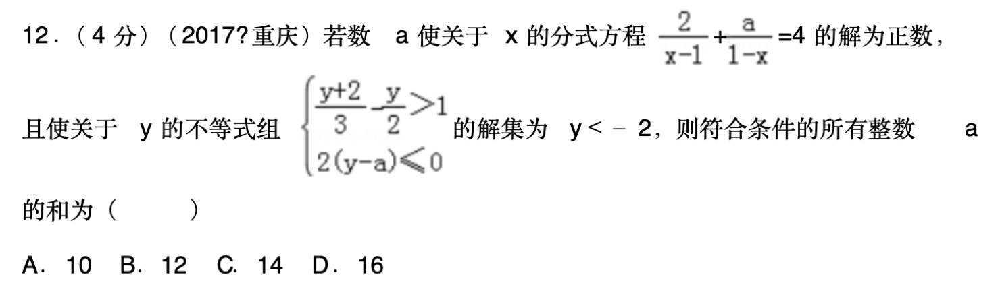

# 案例：从题目图片到知识点与分步解答

本案例展示数学辅导 Agent 如何将题目图片整理为可供前端展示的知识点、步骤和答案，并说明如何核对结果。题目截图和生成结果由项目使用者提供，原始响应保存在 [response.json](../../examples/cases/rational-equation/response.json)。本次整理没有重新调用 Gemini；模型名称、调用时间、配置、耗时、费用及当时的质量检查日志未提供，不作推断。

这是一道初中数学题，作为扩展展示样例。当前项目的首期交互面向小学数学，单道初中题的正确解答不代表已完成初中产品适配或效果评测。

## 1. 输入题目



若数 $a$ 使关于 $x$ 的分式方程

$$
\frac{2}{x-1}+\frac{a}{1-x}=4
$$

的解为正数，且使关于 $y$ 的不等式组

$$
\begin{cases}
\frac{y+2}{3}-\frac{y}{2}>1,\\
2(y-a)\le 0
\end{cases}
$$

的解集为 $y<-2$，求符合条件的所有整数 $a$ 的和。

选项：A. 10；B. 12；C. 14；D. 16。

截图作为用户提供的题目素材保留，用于说明输入形式；不将截图中的来源标注作为已核实的出处，也不将题目素材视为项目原创。

## 2. 输出概览

| 字段 | 本次结果 | 展示用途 |
| --- | --- | --- |
| `status` | `solved` | 前端展示完整解答 |
| `problem_text` | 包含分式方程、不等式组、约束及选项的题干 | 供用户核对识别结果 |
| `core_knowledge_points` | 2 个核心知识点 | 展示主要考查内容 |
| `detailed_knowledge_points` | 3 个细分知识点，各自引用父项 | 展示具体技能与层次 |
| `steps` | 10 步，含公式、知识点引用和应用说明 | 分步阅读与追问 |
| `answer` | `A. 10` | 展示最终答案与选项 |
| `clarifications` | 空数组 | 本次结果没有待确认项 |

知识点编号只在本次分析内有效；不是教材知识点标准编码，也不能直接当作跨题知识图谱节点。

### 知识点层次

```text
K1 解含参分式方程
├── DK1 分式方程的定义域与增根检验
└── DK2 分母互为相反数的分式化简与解整式方程

K2 一元一次不等式组的解集与含参问题
└── DK3 根据公共解集确定参数的不等关系
```

### 步骤与知识点关联

| 步骤 | 学生看到的操作 | 返回的知识点引用 |
| --- | --- | --- |
| 1 | 确定分母非零，得到 $x\ne1$ | K1、DK1 |
| 2 | 利用相反数分母调整符号 | K1、DK2 |
| 3 | 在 $x\ne1$ 前提下去分母 | K1、DK2 |
| 4 | 解出 $x=(6-a)/4$ | K1、DK2 |
| 5 | 结合正根和禁值得到 $a<6$、$a\ne2$ | K1、DK1 |
| 6 | 解第一个不等式得到 $y<-2$ | K2 |
| 7 | 解第二个不等式得到 $y\le a$ | K2 |
| 8 | 根据已知交集反推 $a\ge-2$ | K2、DK3 |
| 9 | 综合范围并枚举整数 | K1、K2 |
| 10 | 求和并匹配选项 | K1、K2 |

此表保留返回结果中的引用。第 9、10 步只引用核心知识点，仍满足接口契约；若希望更精确关联，可进一步标注整数枚举和求和技能，不能假定当前结果已包含这些细分知识点。

## 3. 数学核对

下面是对本次结果的独立推导，便于读者判断正确性；它不是生产日志中已执行核验的证明。

### 分式方程的定义域与参数限制

分母非零要求 $x\ne1$。利用

$$
1-x=-(x-1),\qquad \frac{a}{1-x}=-\frac{a}{x-1},
$$

得到

$$
\frac{2-a}{x-1}=4
\implies 2-a=4(x-1)
\implies x=\frac{6-a}{4}.
$$

题设要求 $x>0$，因此 $a<6$。同时必须满足 $x\ne1$，因此 $a\ne2$。特别地，$a=2$ 时原方程左边在定义域内恒为 0，不可能等于 4；不能把整式方程得到的 $x=1$ 当成原方程的解。

### 不等式组的边界条件

第一个不等式两边同乘正数 6：

$$
2(y+2)-3y>6
\implies -y>2
\implies y<-2.
$$

最后一步除以负数，不等号方向改变。第二个不等式得到 $y\le a$。

要求交集恰为 $y<-2$：

- 当 $a\ge-2$ 时，所有 $y<-2$ 都满足 $y\le a$，交集为 $y<-2$。
- 当 $a<-2$ 时，交集变成 $y\le a$，与题设不符。

因此 $a\ge-2$，边界 $a=-2$ 可以取到。

### 整数枚举与答案

综合条件：

$$
-2\le a<6,\qquad a\ne2.
$$

符合条件的整数为 $-2,-1,0,1,3,4,5$，其和为

$$
(-2)+(-1)+0+1+3+4+5=10.
$$

所以本次最终答案 **A. 10 正确**。完整推导也说明为何端点 $-2$ 可取、$6$ 不可取，以及为何必须排除 $2$。

## 4. 案例体现的技术能力

- **图文输入与结构化输出**：把截图中的数学关系整理为统一 JSON，而不是只返回答案字符串。
- **知识点与步骤关联**：核心与细分知识点通过 `parent_id` 建立层次，步骤通过 `knowledge_point_ids` 引用已定义项。
- **关键条件显式表达**：第一步检查分母，后续处理正根、禁值、不等号方向及边界等号。
- **可供程序检查的契约**：Pydantic 可验证知识点唯一、父子关系、步骤编号与状态一致性，不能据此证明全部数学推导正确。

当前质量检查能核验此例最后的纯数值等式；含参数的推导需要额外复核。该静态案例没有当次服务日志，不能据此宣称它曾通过全部生产质量检查。

## 5. 输出仍可改进的地方

这份结果的数学结论正确，但教学表达仍有优化空间：

1. 第 2 步的分母关系和分式符号变化写在 `knowledge_application` 中；`formula` 可以同时展示这两个关系，让只渲染公式区域的前端也能看到依据。
2. 第 2 步到第 3 步之间合并了分子 `2-a`，第 3 步又展开了右侧；可补充 `2-a=4(x-1)` 中间式，帮助基础较弱的学生。
3. 分式方程的知识点定义可以更精确地说“分母含有未知数的方程”，避免将所有含未知数的分式表达都笼统视作分式方程。

上述为整理时的点评，原始响应保持原样，没有将点评后的版本冒充模型原始输出。完整解答用于本案例展示，不能单独证明多轮启发式辅导的效果。

## 6. 如何复现输入

先按 [README](../../README.md) 配置自己的 Gemini Key 并启动 API，在项目根目录执行：

```bash
curl --fail-with-body http://127.0.0.1:8000/v1/analyze/image \
  -F 'image=@./examples/cases/rational-equation/question.png'
```

本例省略 `grade`，不要传初中年级值，当前字段只支持小学 1–6。若服务器配置了 `TUTOR_GRADE`，省略时仍会继承该值；运行此扩展样例时可先取消该配置并重启服务。模型版本、提示词、配置及生成随机性都会影响结果，重新调用不保证与保存 JSON 完全相同。

## 7. 可用于项目展示的描述

> 展示图文题目分析到结构化讲解的案例：输出 2 个核心知识点、3 个细分知识点及 10 个关联步骤，并通过独立推导核对分式禁值、不等式边界、整数枚举和最终答案。保留题目截图、原始响应及改进点评，便于复现与审阅。

本例用于说明功能与可审阅性，不作为模型准确率、成本或学习效果的统计证据。
